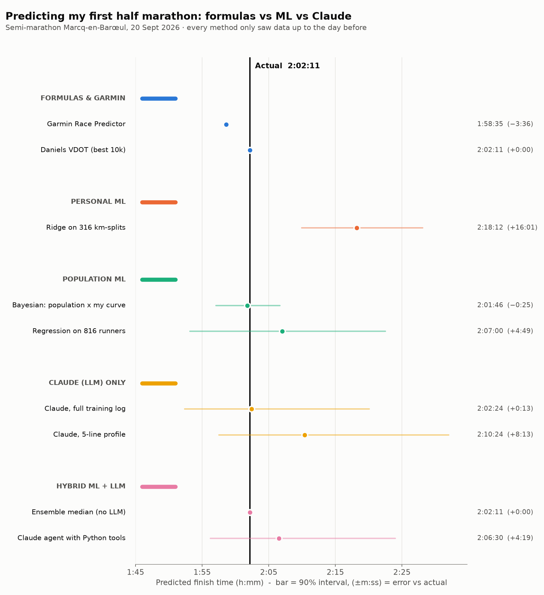
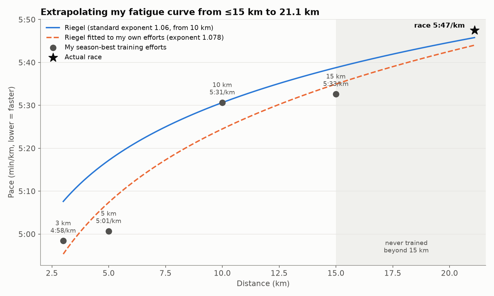
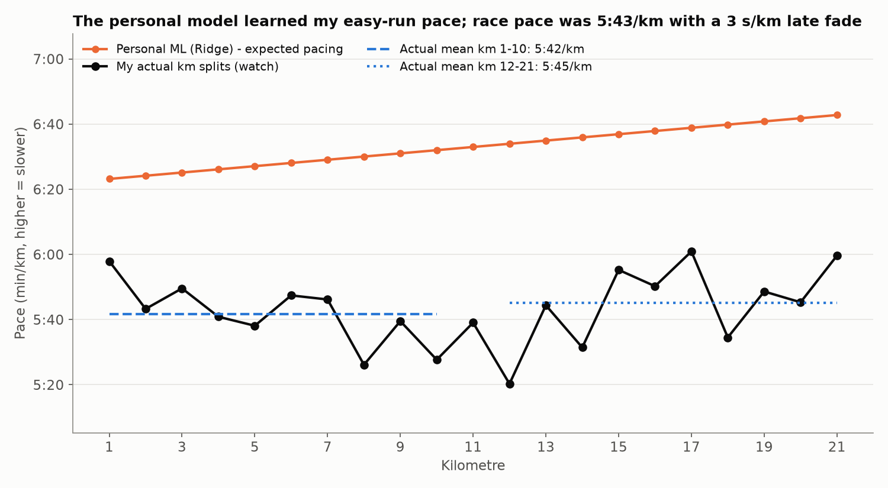
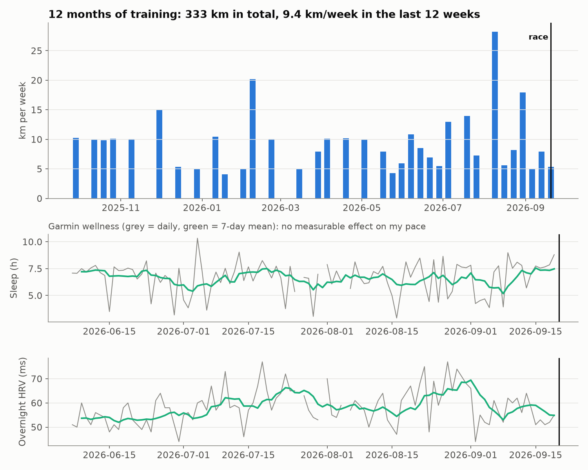
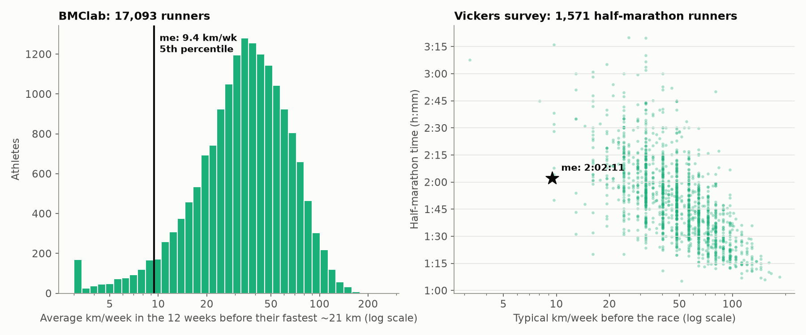

# Predicting my first half marathon: formulas vs ML vs Claude

I ran my first half marathon (Semi-marathon Marcq-en-Barœul, 20 Sept 2026) in **2:02:11**, on about 9 km of training per week.
Afterwards I tried to predict that time **as if it were the night before the race**, using five families of methods, and compared each prediction with the real result.

**Rule:** every model only saw data dated before race day. An assertion in the pipeline enforces this, and the race result is loaded in exactly one place ([src/evaluate.py](src/evaluate.py)).



## Results (headline methods)

| Family | Method | Prediction | Error |
|---|---|---|---|
| Formulas & Garmin | Daniels VDOT from best 10 km | 2:02:11 | 0:00 (luck, see below) |
| | Garmin Race Predictor | 1:58:35 | −3:36 |
| Personal ML | Ridge regression on 316 km-splits | 2:18:12 | +16:01 |
| Population ML | Bayesian: population prior × my own fatigue curve | 2:01:46 | −0:25 |
| | Regression trained on 816 runners | 2:07:00 | +4:49 |
| Claude only | Claude Opus 5.5, full training log | 2:02:24 | +0:13 |
| | Claude Opus 5.5, 5-line profile | 2:10:24 | +8:13 |
| Hybrid | Median of all formula/ML predictions | 2:02:11 | 0:00 (lands on the VDOT row) |
| | Claude agent calling Python tools | 2:06:30 | +4:19 |

All 31 predictions with 90% intervals: [outputs/results.md](outputs/results.md) · [chart](outputs/chart1_all_methods.png)

**On the two zero-error rows:** with one race, a perfect hit is luck, not validation. The VDOT row landed 0.3 s from the real time, and the ensemble median of 21 predictions happens to be that same row. The more useful signal is which families were consistently close and which had honest uncertainty.

## What I learned

1. **Small data isn't ML-ready.** 42 runs, mostly easy, mean the personal models learned my *jogging* pace. Leave-one-run-out cross-validation looked reasonable (22–24 s/km MAE), but the race-day extrapolation missed by 16–27 min. Tree models also can't extrapolate beyond my 15 km longest run.
2. **Domain knowledge and population data do the heavy lifting.** Formulas from a good 10 km effort landed within a minute. Transfer learning from other runners, combined with my own curve through a Bayesian update, gave the narrowest 90% interval that still contained the truth (1:57:04–2:06:39).
3. **LLM accuracy depends on context.** The same model went from +8:13 with a 5-line profile to +0:13 with the full log. The small model (Haiku 4.5) made a unit error (a 33-minute half marathon), which is a good argument for giving LLMs calculation tools.
4. **Hybrids were over-cautious.** When Claude saw the slow personal-ML outputs, or low-volume runners from the survey, it expected me to fade badly (+4 to +10 min). I actually faded by only 3 s/km.
5. **Wearable wellness data had no measurable effect.** Previous-night sleep, HRV, resting HR and body battery didn't explain my pace residuals (19 runs, all |ρ| ≤ 0.21, p > 0.38). Garmin's VO2max estimate (51.2) implies a 1:29 half marathon.

## Methods

| Family | What | Code |
|---|---|---|
| M1 Formulas | Riegel, Riegel with an exponent fitted to my best efforts (bootstrap interval), Cameron, Jack Daniels VDOT (from 10 km and from Garmin VO2max), Garmin Race Predictor | [m1_formulas.py](src/m1_formulas.py) |
| M2 Personal ML | Ridge and HistGradientBoosting on per-km splits (distance, fatigue, elevation, heat, training load, heart rate); leave-one-run-out CV; feature set chosen by CV only; quantile GBM interval; sleep/HRV residual analysis | [m2_personal_ml.py](src/m2_personal_ml.py) |
| M3 Population ML | Linear and GBM models trained on 1,571 recreational runners (5 km / 10 km → half-marathon time, volume, age, BMI, fitness); Bayesian calibration with my own fatigue curve; weak-label GBM on 17,093 athletes' training logs | [m3_population_ml.py](src/m3_population_ml.py) |
| M4 Claude only | Claude Opus 5.5 and Haiku 4.5, minimal vs full context, structured JSON output, 5 samples each | [m4_llm.py](src/m4_llm.py) |
| M5 Hybrid | RAG (20 nearest survey runners → Claude), Claude judging the M1–M3 outputs, a Claude agent with 10 Python tools (Anthropic tool runner), equal-weight and inverse-variance ensembles | [m5_hybrid.py](src/m5_hybrid.py) |

Total Claude API cost for the whole study: **$0.78** (responses are cached in [outputs/llm_responses.json](outputs/llm_responses.json), so reruns are free).

## Data

- **Personal:** Strava bulk export (42 pre-race runs: 19 Garmin FIT with heart rate, 22 phone GPX, 1 manual entry) and Garmin Connect daily wellness via [`garminconnect`](https://github.com/cyberjunky/python-garminconnect). Raw files are not in this repo because GPS tracks reveal home locations. The derived outputs in `outputs/` include my training log (dates, paces, heart rate, sleep), but no locations.
- **Vickers AJ, Vertosick EA (2016).** An empirical study of race times in recreational endurance runners. *BMC Sports Sci Med Rehabil* 8:26. [PMC5000509](https://pmc.ncbi.nlm.nih.gov/articles/PMC5000509/) (Additional file 2).
- **BMClab (UFABC), 2021.** A public dataset on long-distance running training in 2019 and 2020. [figshare 16620238](https://figshare.com/articles/dataset/A_public_dataset_on_long-distance_running_training_in_2019_and_2020/16620238).
- **Weather:** [Open-Meteo](https://open-meteo.com/). Race morning uses the forecast issued the day before (Previous Runs API), so there's no leakage.

## Run it on your own data

```bash
python -m venv .venv && .venv/Scripts/activate      # macOS/Linux: source .venv/bin/activate
pip install -r requirements.txt
cp .env.example .env                                  # add your Anthropic key + Garmin login
# edit config.yaml: race date/location/Strava activity id, your profile, export folder
python -m src.ingest_strava
python -m src.ingest_garmin
python -m src.ingest_external    # downloads BMClab (155 MB) + weather; put the Vickers xlsx in data/raw/
python -m src.features
python -m src.m1_formulas
python -m src.m2_personal_ml
python -m src.m3_population_ml
python -m src.m4_llm
python -m src.m5_hybrid
python -m src.evaluate
```

## More charts

| | |
|---|---|
|  |  |
|  |  |
